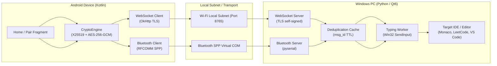
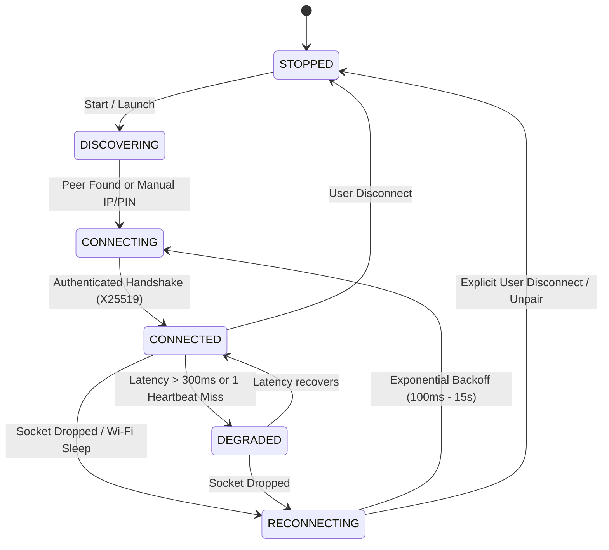

# TypeBridge™ — Universal Hardware Keystroke Streamer

[-green.svg)](https://typebridge.42web.io/)
[-blue.svg)](https://typebridge.42web.io/)

TypeBridge is a high-precision, low-latency cross-platform keystroke streaming bridge that seamlessly streams source code and formatted text from an Android phone directly into a Windows PC as genuine hardware keyboard events (`Win32 SendInput`).

---

## 🏛️ System Architecture

---

## 🔄 Self-Healing Connection State Machine

Both the Android application and the Windows Desktop Assistant maintain a synchronized state machine designed to recover instantly from transient disconnections without user intervention:

### Self-Healing Features:
1. **Persistent Session Identity**: X25519 ECDH keypairs and derived 32-byte shared secrets are securely stored (`desktop_identity.key` in Windows AppData, `EncryptedSharedPreferences` on Android). Reconnecting devices authenticate immediately without re-pairing.
2. **Exponential Backoff with Jitter**: Reconnection attempts start at 100ms, gently ramping to 500ms, 1s, 2s, and capping at 15s. Backoff counters reset once a connection remains stable for >10 seconds.
3. **Half-Open Socket Detection**: Heartbeat pings sent every 3 seconds detect broken or ghost sockets within 10 seconds.
4. **Message Deduplication**: Windows server caches recent `msg_id`s with a 15-minute sliding window, ensuring text is never duplicated if network packets are replayed after reconnection.

---

## ⌨️ Typing Engine & Character Integrity

1. **Hardware-Level Injection**: Emulates genuine OS scan codes via the Windows `SendInput` kernel API (`INPUT_KEYBOARD`).
2. **Tab Expansion**: All tab characters (`\t`) are expanded into exactly 4 space characters prior to injection. Physical `VK_TAB` keys are never emitted.
3. **Smart Indentation Guard**:
   - `Smart Web IDE Mode`: Compensates for editor auto-indentation in platforms like LeetCode, HackerEarth, and VS Code.
   - `Plain Text Mode`: Delivers explicit 4-space indentation for Notepad and raw text editors.
   - `Raw Mode`: Emits characters verbatim.
4. **Full Unicode Support**: Uses `KEYEVENTF_UNICODE` for Indic scripts (Telugu, Hindi), emojis, surrogate pairs, and non-ASCII characters without layout distortion.

---

## 📱 Universal Android Installation Compatibility

TypeBridge Android is engineered for universal compatibility across all Android manufacturers:
- **Supported Android Versions**: Android 8.0 (Oreo, API 26) through Android 15 (Vanilla Ice Cream, API 35).
- **Supported Architectures**: Pure DEX implementation with 0 native `.so` dependencies — runs natively on `arm64-v8a`, `armeabi-v7a`, `x86`, and `x86_64`.
- **Manufacturer Tested**: Samsung (One UI), Xiaomi/Redmi (MIUI & HyperOS), Oppo/Realme (ColorOS), Vivo (FuntouchOS), OnePlus (OxygenOS), Motorola, and Google Pixel.
- **Signing Scheme**: Multi-scheme APK signature verified with **v1 (JAR), v2 (APK Signature Scheme v2), and v3 (APK Signature Scheme v3)**.
- **Foldables & Tablets**: Seamless dynamic orientation and window resizing without socket restarts (`configChanges`).

---

## 🚀 Official Website & Downloads

- **Official Website**: [https://typebridge.42web.io/](https://typebridge.42web.io/)
- **GitHub Repository**: [https://github.com/loki-teche99/typebridge](https://github.com/loki-teche99/typebridge)
- **Windows Setup Installer**: [Download Latest (.exe)](https://github.com/loki-teche99/typebridge/releases/latest)
- **Android APK**: [Download Latest (.apk)](https://typebridge.42web.io/downloads/TypeBridge-Android-v1.0.0.apk)

---

## 🩺 Diagnostics & Support

If you experience connection or typing issues:
1. **Desktop**: Click **Logs** → **🩺 Support Diagnostics** to export a sanitized diagnostic bundle.
2. **Android**: Go to **Settings** → **📋 Copy Support Diagnostics** to copy hardware and connection information.
3. Neither report ever exposes pairing PINs, encryption keys, or source code.
